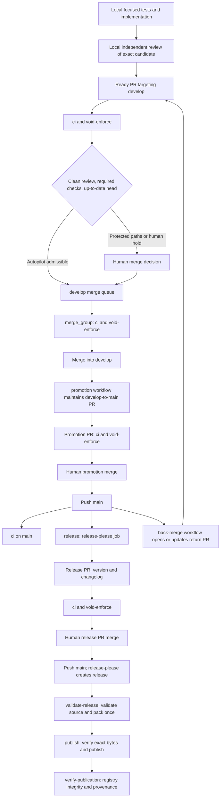
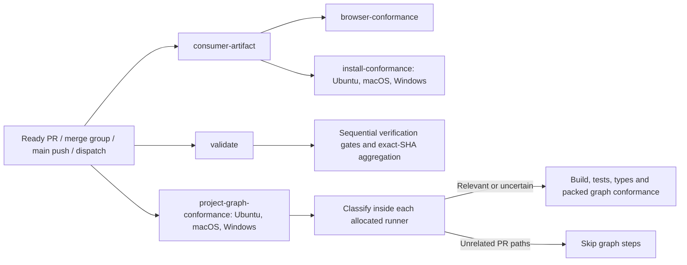
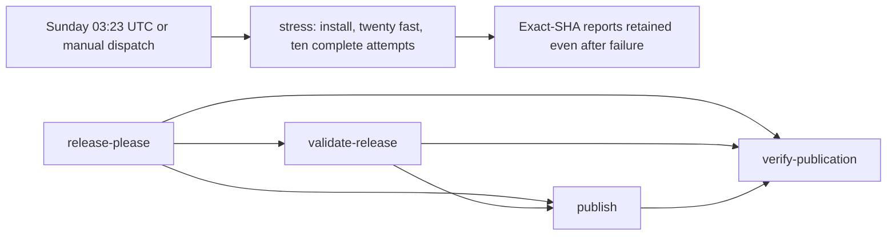
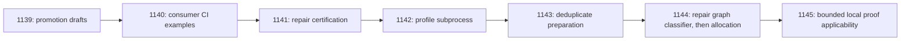

# CI chain

Source snapshot: `08e75a8c`, 5 November 2026. The diagrams describe checked-in
workflow behavior, not live protection settings. The [CI economy programme](plans/2026-11-05-ci-economy-plan.md)
changes this chain incrementally; update this page with each relevant change.

## From local work to publication

The local reviewer and protection decisions are not GitHub Actions jobs. There is
no GitHub model-review workflow. Both promotion and release PR merges remain human
actions; this optimisation programme authorizes neither. A release PR opened with
the Release App token triggers normal PR checks. Back-merges return through the
protected integration path; they are not direct unverified writes to `develop`.

## Current `ci.yml` job DAG

Only artifact-to-browser and artifact-to-install edges are job dependencies in
this workflow. The other arrows inside `validate` and graph jobs show sequential
steps. There are nine jobs after matrix expansion. `void-enforce` runs separately;
`validate` aggregates its own gate reports, not the conformance or enforcement
jobs. GitHub protection and the local merge decision consume required results.

For draft PRs, `consumer-artifact` and graph jobs are skipped; downstream consumer
jobs cannot run. `validate` and `void-enforce` stop at their early admission guard
with non-success before installing dependencies. Marking the PR ready triggers
complete checks without needing another commit. A conversion back to draft
invalidates obsolete PR work. Distinct merge groups, dispatches and release runs
have isolated concurrency keys. Unknown graph relevance currently runs tests.

The PR proof subject is its head SHA; merge-group checks prove the group SHA.
The immutable consumer tarball and source manifest are produced once, then used
by browser and three OS installation jobs. Graph conformance is a separate path.
Current graph classification considers package paths but needs the wider input
and rename coverage in DEV-1144 before allocation can safely be optimized.

## Certification and release job dependencies

Certification is an independent reliability workflow, not a PR status dependency.
At the audited source it installs dependencies but omits compiled prerequisite
preparation; DEV-1141 repairs that before interpreting stress results. The release
DAG additionally has event/result conditions: a normal promotion push proposes a
release PR, while a created release (or supported manual recovery) admits release
validation. See [release policy](RELEASING.md) for the full authority contract.

## Approved changes and measurement order

These arrows show the requested execution order. Linear owns real blockers;
DEV-1142 depends on DEV-1141's reliability prerequisite. One worker preserves
ordering across shared files. Protected PRs wait for a person's merge after
review; other admissible PRs use the existing autopilot path. New promotion PRs
will be drafts, while an existing ready promotion keeps its human-selected state.
The full [baseline and limits](specs/2026-11-05-ci-economy.md) distinguish total
job-minutes from latency and potential avoidance from demonstrated savings.

## Open the real graph

Open a run from [CI](https://github.com/voidcorp-core/void-machine/actions/workflows/ci.yml),
[enforcement](https://github.com/voidcorp-core/void-machine/actions/workflows/void-enforce.yml),
[promotion](https://github.com/voidcorp-core/void-machine/actions/workflows/promotion.yml),
[certification](https://github.com/voidcorp-core/void-machine/actions/workflows/test-certification.yml)
or [release](https://github.com/voidcorp-core/void-machine/actions/workflows/release.yml).
Each run summary shows GitHub's actual job graph and links each node to its logs.
The graph belongs to that run, so it also shows skipped and failed jobs; this
static page supplies the cross-workflow context. See GitHub's
[visualization graph guide](https://docs.github.com/en/actions/how-tos/monitor-workflows/use-the-visualization-graph),
[event reference](https://docs.github.com/en/actions/reference/workflows-and-actions/events-that-trigger-workflows)
and [job-condition semantics](https://docs.github.com/en/actions/how-tos/write-workflows/choose-when-workflows-run/control-jobs-with-conditions).
