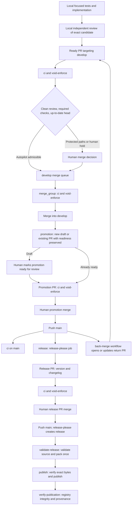
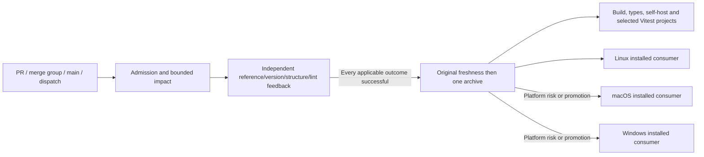
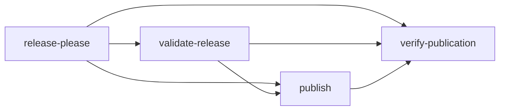

# CI chain

Source baseline: `08e75a8c`, 5 November 2026, updated here for DEV-1139 promotion
drafts. The diagrams describe checked-in workflow behavior, not deployed workflow
or live protection settings. The [CI economy programme](plans/2026-11-05-ci-economy-plan.md)
changes this chain incrementally; update this page with each relevant change.

## From local work to publication

The local reviewer and protection decisions are not GitHub Actions jobs. There is
no GitHub model-review workflow. Both promotion and release PR merges remain human
actions; this optimisation programme authorizes neither. A release PR opened with
the Release App token triggers normal PR checks. Back-merges return through the
protected integration path; they are not direct unverified writes to `develop`.

## Consumer CI without a queue service

The diagram above describes this repository's configured GitHub queue, not a
consumer prerequisite. Consumers can merge sequentially with the existing
Autopilot kernel: an armed PR retains its turn, otherwise the oldest open,
non-draft PR among tracked tickets takes it. Refresh only the branch whose turn
it is, then require current review and CI evidence. The merge skill preserves
this order rather than preferring a newer green PR; real dependencies and durable
blockers are reported explicitly, never resolved by bypassing the kernel.

The shipped [CI feedback reference](../packages/core/src/skills/void-verify/references/ci-feedback.md#measure-feedback-before-changing-ci)
owns the measurement procedure and advisory latency targets. It separates waiting,
elapsed time, summed job-minutes and billing, includes cancelled/repeated work, and
requires actual dependency evidence before avoiding a suite on documentation changes.
There is no new queue, CLI command, budget gate or automatic protection change.
`init` installs these skill references; `update` refreshes owned references while
preserving project edits. Existing consumer workflows remain project-owned.

## Current `ci.yml` job DAG

The producer `consumer-artifact` runs admission before dependency installation. A
required `validate` job runs even after producer failure and explicitly refuses any
producer result other than success. The four independent cheap steps collect errors
with native outcomes; their barrier rejects missing/skipped/cancelled required work
before archive preparation. Build failure stops build-dependent checks. No test retry
or suite bail is imposed. The source freshness comparison precedes lifecycle repairs.

Three explicit OS jobs retain the exact required names `install conformance
(ubuntu-latest)`, `(macos-latest)` and `(windows-latest)`. Native YAML anchors share their
steps. A non-applicable job is skipped, not a passed consumer test; unlike a filtered
workflow or omitted matrix row, its required context remains conclusive. The separate
`enforce` job remains required. There are five CI job instances at full scope, plus
separate enforcement, with no generator or gate-report round trip.

Selection uses the complete local Git diff against the event base. Queue groups diff
the combined HEAD against `merge_group.base_sha`; they never reuse isolated PR proof.
Explanatory Markdown under `docs/` plus root README/CONTRIBUTING retains references
and enforcement. Product Markdown and build inputs are not exempt. Test-only edits
select the corresponding existing Vitest project. Pure engine policy leaves retain
all three projects because CLI/runtime depend on them, with Linux consumer coverage.
Everything else, including rename/delete, shared fixtures, lockfiles, CI, install,
file/process concerns, unknown paths and unavailable/incomplete diffs, runs full scope.

Develop PRs prove their branch head. Main PRs prove the current synthetic merge SHA
and run all projects and supported OS; strict main protection requires an up-to-date
candidate. Main push/manual runs are full too. Draft admission remains explicitly
non-success before heavy work. Ready/synchronize events refresh proof; existing ready
promotions remain ready and new promotions stay draft until a human prepares them.
Only obsolete PR runs cancel. Main publication and distinct queue groups never coalesce.
No operation here marks ready, merges or publishes to main.

Autopilot reads current checks through one adapter for both its tick and the
merge/arm guard. GitHub's rollup can retain a draft failure alongside the ready
success on the same SHA. The adapter reads all context pages and joins Actions
runs by check-suite identity. A higher `run_number` replaces a same-name job only
for the same application, workflow, `pull_request` event and exact PR/head/base
association, including repository IDs and SHAs. It never selects by conclusion,
completion time or display workflow name. Separate producers, other events,
missing associations and ambiguous same-suite reruns retain their outcomes.
Current pending or failed workflows also block before replacement jobs appear.
A same-head, same-branch PR workflow with absent or ambiguous PR association stays
non-success even without jobs; an explicit association only to other PRs remains
unrelated. Uncertain association cannot supersede another run's result.

Both API surfaces are bounded to ten pages of 100; missing fields, duplicate IDs,
count/cursor gaps, GraphQL errors or a changed head refuse observation. Classic
status contexts remain checks; a confirmed empty repository still reports none.
This requires read access to the Actions API as well as checks; an access failure
is explicit, never a green fallback. Queue proof semantics and GitHub protection
are unchanged. See the [current-check decision](decisions-log/2026-11-06-current-pull-request-checks--40cc09ad-6073-4521-aa02-f034818028e0.md).

## Release job dependencies

DEV-1407 retires the weekly/manual certification workflow and its stress runner. Historical
reports and the November audit remain historical evidence, not a requirement to rerun a
campaign. For an explicitly requested ordering diagnosis after building prerequisites, run
`pnpm exec vitest run path/to/file.test.ts --sequence.shuffle --sequence.seed=10401`.
`pnpm test:network --sequence.shuffle --sequence.seed=20401` retains the bounded loopback probe,
thread pool, one worker and one 120-second Vitest invocation. Unsupported arguments refuse;
the first failing invocation remains red. No extra `--` separator precedes Vitest options.
See the [Vitest sequence contract](https://vitest.dev/config/sequence).

The release DAG additionally has event/result conditions: a normal promotion push proposes a
release PR, while a created release (or supported manual recovery) admits release
validation. See [release policy](RELEASING.md) for the full authority contract.

## Measurement limits

DEV-1408 removes CI generation/reports and the remaining repository pre-commit.
In selector fixtures, docs avoid all three test projects and consumer jobs; an engine
test edit avoids two projects and three consumer jobs; a pure policy source keeps all
projects and avoids two OS consumers. These are structural savings, not measured
runner minutes or billing. Prior graph/browser/test-campaign removals and DEV-1143
archive reuse are not counted again. Actual remote OS evidence belongs to each run.

## Open the real graph

Open a run from [CI](https://github.com/voidcorp-core/void-machine/actions/workflows/ci.yml),
[enforcement](https://github.com/voidcorp-core/void-machine/actions/workflows/void-enforce.yml),
[promotion](https://github.com/voidcorp-core/void-machine/actions/workflows/promotion.yml)
or [release](https://github.com/voidcorp-core/void-machine/actions/workflows/release.yml).
Each run summary shows GitHub's actual job graph and links each node to its logs.
The graph belongs to that run, so it also shows skipped and failed jobs; this
static page supplies the cross-workflow context. See GitHub's
[visualization graph guide](https://docs.github.com/en/actions/how-tos/monitor-workflows/use-the-visualization-graph),
[event reference](https://docs.github.com/en/actions/reference/workflows-and-actions/events-that-trigger-workflows)
and [job-condition semantics](https://docs.github.com/en/actions/how-tos/write-workflows/choose-when-workflows-run/control-jobs-with-conditions).
